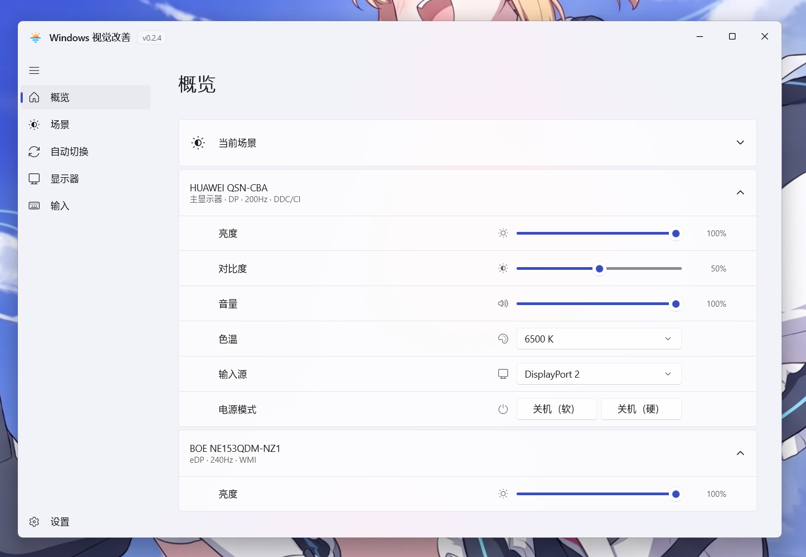
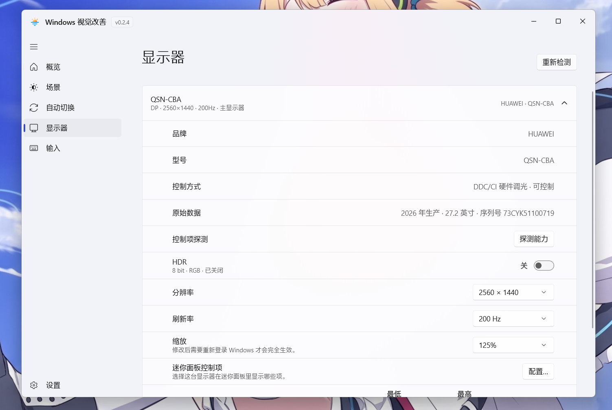
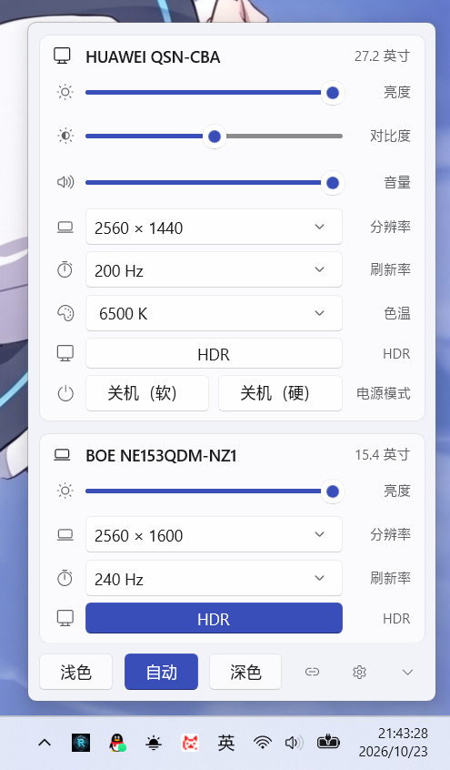
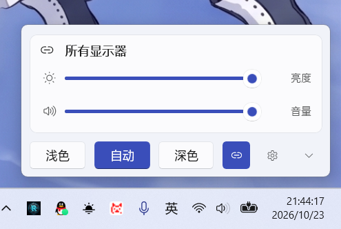

<h1 align="center">
  
  <br />
  Windows 视觉改善
</h1>

<p align="center">
  
  
  
  
  
</p>

<p align="center">
  
</p>

<p align="center">
  
  
  
</p>

---

## 这是什么

Windows 自带的「夜间模式」只调色温，显示器自带的 OSD 菜单要按实体按键，一次只能调一台。

BetterScene 支持统一快速或自动调节

## 功能特性

- **逐屏亮度控制**
- **场景一键切换** 
- **迷你面板**
- **按时间或系统联动自动切**
- **触发条件过滤**
- **HDR 感知**
- **显示器细节可调**
- **常驻内存个位数**
- **原生体验**

## 快速开始

### 下载安装

从 [Releases](https://github.com/iwvw/BetterScene/releases/latest) 下载，按需选择：

| 文件 | 说明 |
|---|---|
| `BetterScene-x.y.z-x64-merged-setup.exe` | **推荐**。自带运行时，双击安装即可 |
| `BetterScene-x.y.z-x64-split-setup.exe` | 体积小，需要系统已装 .NET 10 运行时 |
| `*-portable.zip` | 免安装，解压后运行 `BetterScene.exe` |

ARM64 设备选对应架构的包。

### 首次使用

1. 启动后程序常驻托盘。**左键**托盘图标弹出迷你面板，**右键**是菜单：打开主界面、切换明暗、暂停自动切换、设置、退出。
2. 进「场景」页，给浅色和深色各挑一张壁纸。
3. 进「显示器」页，确认每台屏都被识别到、亮度能正常调节。
4. 需要的话在「自动切换」页配置规则。

### 从源码构建

需要 [.NET 10 SDK](https://dotnet.microsoft.com/download) 和 Windows 10 1809 以上。

```powershell
git clone https://github.com/iwvw/BetterScene.git
cd BetterScene
dotnet build BetterScene.slnx -p:Platform=x64
```

产物在 `src/BetterScene.App/bin/Debug/net10.0-windows10.0.26100.0/win-x64/BetterScene.exe`。

也可以直接用仓库里的脚本：

```powershell
.\run.ps1      # 编译并启动
.\dev.ps1      # 开发循环
```


## 技术栈

| 类别 | 使用 |
|---|---|
| 运行时 | .NET 10 |
| UI | WinUI 3（Windows App SDK）、CommunityToolkit.WinUI |
| 亮度 | DDC/CI（`dxva2.dll`）、WMI（`root\WMI`）、gamma ramp |
| 显示配置 | CCD API（`DisplayConfigGetDeviceInfo` / `SetDeviceInfo`） |
| 托盘 | H.NotifyIcon.WinUI |
| 窗口 | WinUIEx |

## 项目结构

```
BetterScene.slnx
├─ src/BetterScene.App/        WinUI 3 主界面、迷你面板、托盘
├─ src/BetterScene.Core/       共享逻辑：设置、主题、日志、显示器控制
├─ src/BetterScene.Displays/   显示器工作者（独立进程）
├─ tests/BetterScene.Core.Tests/
└─ build/                      打包与资源生成脚本
```

## 已知限制

- **DDC 写入受显示器固件影响**：少数型号在 HDR 下会锁死背光，此时改用 gamma 调光，效果是画面变暗而非背光变暗。
- **缩放修改需要重新登录**：Windows 的 DPI 缩放在登录时读取，改完要注销重进才完全生效。
- **内屏没有 DDC**：笔记本内屏基本都不支持 DDC/CI，走 WMI 背光；部分机型连 WMI 也被厂商驱动占用。

## 贡献指南

欢迎提 Issue 反馈问题，尤其是**特定显示器的兼容性**——不同厂商的 DDC 实现差异很大，你的实测数据对改进很有价值。

提 Issue 时建议附上：

- 显示器型号（EDID 里的型号代码，如 `HWV6246`）
- 连接方式（DP / HDMI / eDP / Type-C）
- 日志：`%LOCALAPPDATA%\BetterScene\app.log` 与 `displays.log`

提交代码前请跑一遍测试：

```powershell
dotnet test tests/BetterScene.Core.Tests/BetterScene.Core.Tests.csproj -p:Platform=x64
```

## 许可证

[MIT](LICENSE) © DSUK

---

<p align="center">
  <sub>感谢并认可 <a href="https://linux.do/">LINUX DO</a> 社区</sub>
</p>
